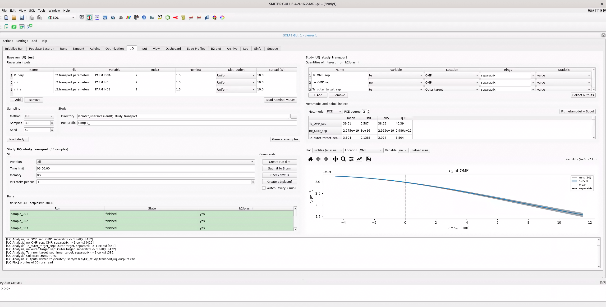
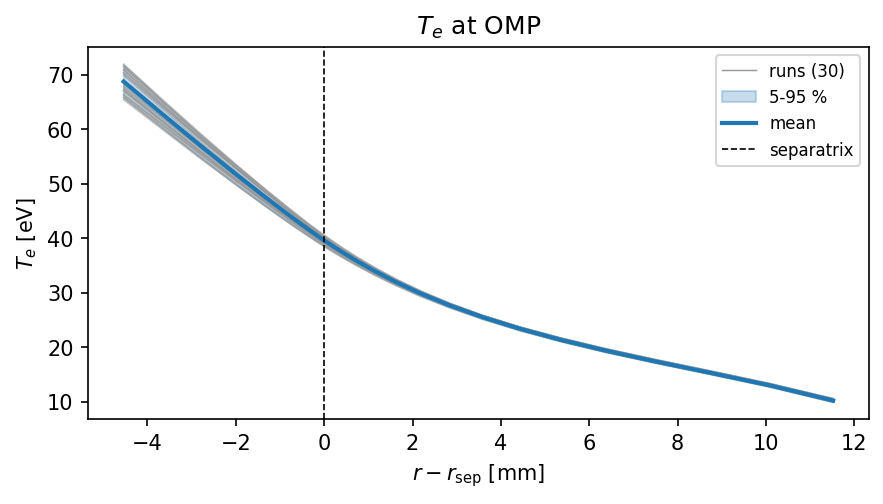
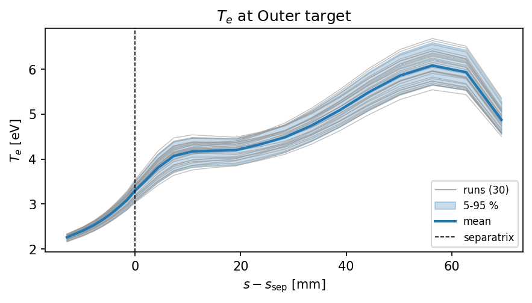
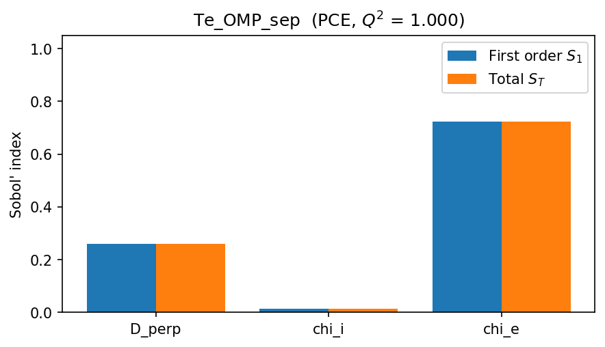
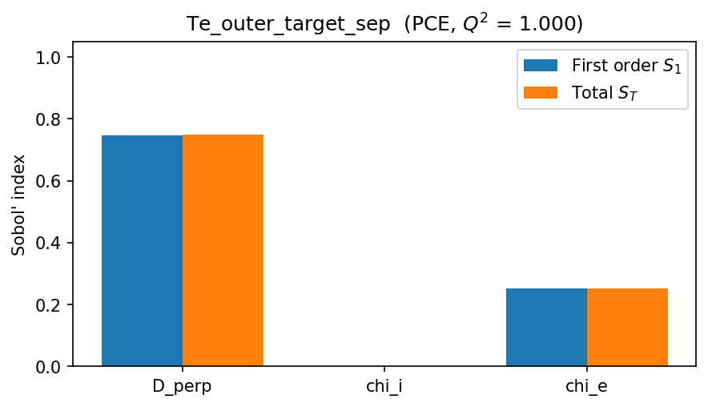
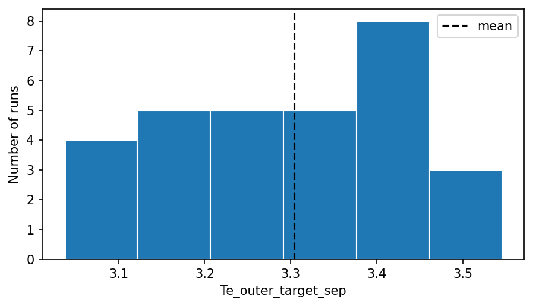
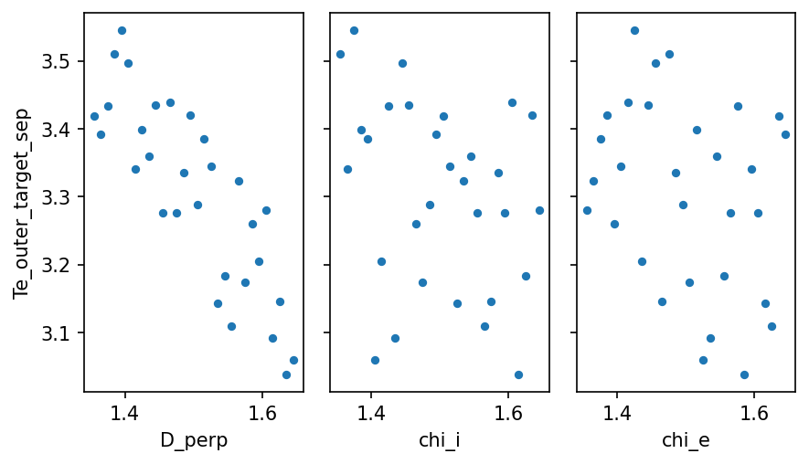

.. highlight:: python

===================================
Uncertainty Quantification Workflow
===================================

Introduction
============

Within this tutorial we will create an **uncertainty quantification**
(UQ) actor that will use *OpenTURNS* library to prepare SOLPS-ITER cases.

Uncertainty quantification answers two questions: how much do the
results of a SOLPS-ITER case change when uncertain inputs vary, and which
input causes most of that change. The UQ tab of SOLPS GUI does this in
four connected actors:

* **UQ Setup** defines the uncertain inputs and samples them,
* **UQ Runs** creates one SOLPS-ITER run per sample and submits the
  runs to Slurm,
* **UQ Analysis** reads the quantities of interest from ``b2fplasmf``,
  fits a polynomial chaos expansion (PCE), a fast approximation of
  SOLPS-ITER, and computes the Sobol' sensitivity indices from it,
* **UQ Plot** shows the profiles of all runs and the results.

As an example we use the COMPASS case 16515 at 1150 ms with the base run
``UQ_test``. The uncertain inputs are the three anomalous radial transport
coefficients in ``b2.transport.parameters``. They are not measured and are
usually tuned to experiments, so their values are uncertain:

=========  ============  ==================================================
Name       Variable      Meaning
=========  ============  ==================================================
D_perp     ``PARM_DNA``  particle diffusion coefficient :math:`D_\perp`
                         [m\ :sup:`2`/s]
chi_i      ``PARM_HCI``  ion heat diffusivity :math:`\chi_i` [m\ :sup:`2`/s]
chi_e      ``PARM_HCE``  electron heat diffusivity :math:`\chi_e`
                         [m\ :sup:`2`/s]
=========  ============  ==================================================

In the file every coefficient is a list of values per species, for example
``PARM_DNA= 0.00, 1.5`` for neutral D and D\ :sup:`+`. The *Index* column
of UQ Setup selects the value that is changed: index 2 (D\ :sup:`+`) for
``PARM_DNA`` and ``PARM_HCI``, index 1 for ``PARM_HCE``. The nominal value
of all three is 1.5 m\ :sup:`2`/s and each varies uniformly by ±10 %,
i.e. between 1.35 and 1.65 m\ :sup:`2`/s. A Latin hypercube sample (LHS)
of 30 points (seed 42) gives 30 SOLPS-ITER runs. The quantities of interest
are the electron temperature and density at the separatrix at the outer
midplane (OMP) and at the targets.

The figure below shows the UQ tab after all 30 runs have finished. The
runs table of UQ Runs is green, UQ Analysis gives the mean, standard
deviation and 5 % and 95 % quantiles of every quantity (for example
:math:`T_e` at the OMP separatrix is 39.6 ± 0.6 eV) and UQ Plot shows the
electron density profile at the OMP of all 30 runs with their mean and
5-95 % band.

Running a UQ study step by step
-------------------------------

1. In the :menuselection:`Runs` tab select the case and click its
   ``baserun``.
2. In the :guilabel:`Initialize Run` tab choose your case (for example
   ``UQ_test``) in :menuselection:`Select run dir`. Open the
   :menuselection:`UQ` tab; UQ Setup shows *Base run: UQ_test*.
3. In UQ Setup check the uncertain inputs (add more with
   :guilabel:`+ Add`) and click :guilabel:`Read nominal values`.
4. Set :menuselection:`Method` to ``LHS``, :menuselection:`Samples` to
   ``30`` and :menuselection:`Seed` to ``42``.
5. In :menuselection:`Directory` enter the path of a new folder, for
   example ``/scratch/users/vasilei/UQ_study_transport``, and click
   :guilabel:`Generate samples`.
6. In UQ Runs check the Slurm settings (:menuselection:`Partition` ``all``,
   :menuselection:`Time limit` ``06:00:00``, :menuselection:`Memory`
   ``8G``) and click :guilabel:`Create run dirs`. Click
   :guilabel:`Submit to Slurm` and :guilabel:`Yes`. When all rows of the
   runs table are green, click :guilabel:`Create b2fplasmf` and wait until
   the :menuselection:`b2fplasmf` column shows ``yes`` for all runs.
7. UQ Analysis then collects the outputs automatically and UQ Plot shows
   the profiles. To add more quantities of interest click
   :guilabel:`+ Add` and choose their :menuselection:`Location` and
   :menuselection:`Rings`; after any change click
   :guilabel:`Collect outputs`.
8. Set :menuselection:`Metamodel` to ``PCE`` and
   :menuselection:`PCE degree` to ``2`` and click
   :guilabel:`Fit metamodel + Sobol`.
9. In UQ Plot choose :menuselection:`Plot --> Profiles (all runs)`, then
   the :menuselection:`Location` (``OMP``, ``Outer target`` or
   ``Inner target``) and the :menuselection:`Variable` (``te``, ``ti``,
   ``ne`` or ``ni``).
10. To show the Sobol' indices choose
    :menuselection:`Plot --> Sobol' indices` and the quantity of interest
    in :menuselection:`QoI`.

What ±10 % on the inputs does to the outputs
--------------------------------------------

The following figures are saved from **UQ Plot** with the save button of
its toolbar, after choosing the plot type in :menuselection:`Plot`.

:menuselection:`Plot --> Profiles (all runs)` with *Location* ``OMP`` and
*Variable* ``te`` shows the electron temperature of all 30 runs (grey), their
mean (blue) and the 5-95 % band. At the OMP the profiles differ mostly
inside the separatrix; at the separatrix :math:`T_e` is 39.6 ± 0.6 eV.

With *Location* ``Outer target`` the spread is larger relative to the
values and covers the whole target. At the separatrix :math:`T_e` is
3.3 ± 0.14 eV (mean ± one standard deviation), i.e. a standard deviation of
4 %, while the inputs, uniform within ±10 %, have a standard deviation of
5.8 %.

:menuselection:`Plot --> Sobol' indices` shows, for the quantity selected in
*QoI*, the first order index :math:`S_1` (blue: effect of the input alone)
and the total index :math:`S_T` (orange: effect including interactions with
the other inputs). The title gives the metamodel and its :math:`Q^2`; a
value close to 1 means that the PCE reproduces the runs well. For
``Te_OMP_sep`` the electron heat diffusivity ``chi_e`` explains 72 % of the
variance and the particle diffusion ``D_perp`` 26 %; ``chi_i`` has no
effect.

For ``Te_outer_target_sep`` the order changes: ``D_perp`` explains 75 % of
the variance and ``chi_e`` 25 %. :math:`S_1` and :math:`S_T` are equal for
every input, so the inputs do not interact in this range.

:menuselection:`Plot --> Histogram` shows how the 30 values of a quantity of
interest are spread, here ``Te_outer_target_sep`` between 3.0 and 3.55 eV,
with the mean as a dashed line.

:menuselection:`Plot --> Scatter vs inputs` plots the quantity of interest
against every input and shows the Sobol' result directly: the outer target
:math:`T_e` falls clearly when ``D_perp`` grows, shows a weak trend with
``chi_e`` and no trend with ``chi_i``.

Generating Actor
================

Select :menuselection:`SOL --> SOLPS --> Actor Generator` and do the
following settings

1. Type `My UQ` in :guilabel:`Actor display name`
2. Select or type group :guilabel:`group` as `Workflow`
3. Add desctiprion under :guilabel:`toolTip`
4. Optionally remove pulse XML section from :menuselection:`XML_DOM`
   since we will node be using it.
5. Select an icon in the list of icons
6. Set :guilabel:`Actor Directory` to :file:`~/Documents/actors` and
   :guilabel:`Plugin Diretcory` to :file:`~/Documents/plugins`
   The directory settings can be also set before running the generator
   with :menuselection:`File --> Preferences --> SOL`
7. Use :kbd:`CTRL+S` or :menuselection:`File --> Save` to save all actor
   files in the directories specified. 

   The actor generator should look like in the following figure.

   .. image:: uq-actor1.png
      :align: center

8. The generator already prepared a test workflow with :file:`myuq.ui`
   file that can be stested by setting :menuselection:`File -->
   Preferences --> SOL --> Workflow Load UI` to
   :file:`~/Documents/plugins/myuq.ui` and :guilabel:`Apply` and
   :guilabel:`OK`

9. Test the default workflow by :menuselection:`SOL --> Workflow ->
   Load workflow UI` and then :guilabel:`Start` or :guilabel:`Compute`
   button.

10. Edit :file:`~/Documents/actors/myuq.py` and add replace `compute()` slot
    with the following

.. code-block:: python

   @Slot()
   def compute(self):
        self._running_state = 1
        self._log.appendPlainText("Generating samples...")
        try:
            import openturns
        except ImportError:
            QMessageBox.critical(self, 'UQ', 'OpenTURNS is not available in this Python.')
            return
        import numpy

        nominal = 1.5
        spread = 0.1*nominal
        marginal1 = openturns.Uniform(nominal-spread, nominal+spread)
        marginal2 = openturns.Uniform(2.0, 3.0)
        marginal3 = openturns.Uniform(2.5, 3.6)        
        marginals = [marginal1, marginal2, marginal3]
        distribution =  openturns.JointDistribution(marginals)
        distribution.setDescription(["parm_dna", "parm_hci", "parm_hce"])
        size = 30
        experiment = openturns.LHSExperiment(distribution, size)
        samples = numpy.array(experiment.generate())
        self._log.appendPlainText(str(samples))
        self.finished.emit()
        self._running_state = 2       

11. Restart the workflow by pressing :kbd:`ESC` and click in the
    Workflow area to get new actor code reloaded. Repeating
    :guilabel:`Compute` will list 30 samples of SOLPS parameters to be
    changed in each :file:`b2.transport.parameters` sample run.

With a help of Artificial Intelligence one may extend the initial
actor to have a table of parameters to be used for UQ sampling,
generate modified files and reference baseline case files in
:file:`runs` directories creation.

Additional actors for batch submission, group postprocessing and
plotting may be created as shown in this tutorial *Introduction* and
now found under :file:`solps.ui` worklow tab.
