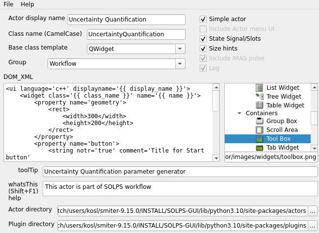

.. highlight:: python

===================================
Uncertainty Quantification Workflow
===================================

Introduction
============

Within this tutorial we will create an **uncertainty quantification**
(UQ) actor that will use *OpenTURNS* library to prepare SOLPS-ITER cases.

Generating Actor
================

Select :menuselection:`SOL --> SOLPS --> Actor Generator` and do the
following settings

  1. Type `Uncertainty Quantification` in :menuselection:`Actor display name`
  2. Select or type group :menuselection:`group` as `Workflow`
  3. Add desctiprion under :menuselection:`toolTip`
  2. Optionally remove pulse XML section from :menuselection:`XML_DOM`
     since we will node be using it.
  3. Select an icon in the list of icons

The actor generator should look like in the following figure.

